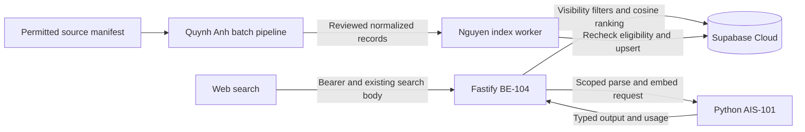

# AI Search implementation, taxonomy and data work plan

Prepared on 2026-11-12 for Khoi Nguyen and Quynh Anh. Target checkpoint is
2026-11-15 at 23:59, Asia/Saigon, using the shared end-of-day planning assumption.

## 1. Priority and inspected evidence

AI Search is the highest-priority AI feature for this reconstruction. Build the code
path and a repeatable permitted-data/indexing path together. The first demo retrieves
photographers/studios from published portfolio evidence for English and Vietnamese
queries, with explicit filters, useful matched images and measurable quality.

`dev` at `30e5373` contains a FastAPI health scaffold. The fetched MVP reference at
`66f3779` implements search inside Fastify/TypeScript. Read these guides first.

- [Current capabilities](current-ai-capabilities.md) and
  [target architecture](target-ai-architecture.md).
- [Internal service contract](ai-service-contract.md),
  [dataset requirements](dataset-requirements.md) and
  [implementation roadmap](implementation-roadmap.md).
- [Backend allocation](../backend/mvp-rebuild-work-plan.md) and
  [Database guide](../database/mvp-cloud-work-guide.md).
- [Agent entrypoint](../../agents/README.md) and [contribution rules](../contributing.md).

### Reference files to inspect

| MVP path                                                                   | Reusable behavior and gaps to account for                                                                                                                                                           |
| -------------------------------------------------------------------------- | --------------------------------------------------------------------------------------------------------------------------------------------------------------------------------------------------- |
| `packages/shared/src/business.ts`                                          | Eight genres, search request/parsed/result schemas, filter overrides, provenance and job status enums.                                                                                              |
| `apps/api/src/services/search.ts`                                          | Parse, embed, filter candidate providers, cosine rank visible images, group providers, keep at most three matched images, paginate and localize reasons. Candidate discovery currently caps at 500. |
| `apps/api/src/services/ai.ts`                                              | Visual description, bilingual parsing, exact 768-finite-vector validation, reservations and provider failure handling.                                                                              |
| `apps/api/src/services/ai-jobs.ts`, `repositories/ai-jobs.ts`, `worker.ts` | Index job claim/recheck/upsert, queue redelivery, unknown outcome and budget handling.                                                                                                              |
| `apps/api/src/index-portfolios.ts`                                         | Up to 200 eligible images, model-aware existing-index checks and active-job deduplication. Localhost guard requires Cloud redesign.                                                                 |
| `apps/api/src/evaluate-search.ts`                                          | 100 indexed-image prerequisite, 30 expected-provider queries, top-five hit fraction and 0.8 threshold. Localhost and fake-account assumptions require redesign.                                     |
| `fixtures/search-evaluation.json`                                          | 30 cases for six seeded providers. The inspected Vietnamese strings contain literal `?` corruption. Rewrite from human-reviewed UTF-8 originals.                                                    |
| `apps/api/src/demo-seed.ts`                                                | Twelve original Unsplash references, fictional provider records and later copies across portfolios. Expand with unique permitted assets and explicit attribution.                                   |
| `supabase/migrations/20261030000100_mvp_core.sql`                          | `image_embeddings` with `vector(768)`, one active row per image, model string, tags and image-tag relationship.                                                                                     |
| `supabase/migrations/20261030000200_mvp_workflows.sql`                     | Nine starter tags, queue/budget rules and Storage policies.                                                                                                                                         |

```powershell
git show feature/MVP-001-ai-focused-workflow:apps/api/src/services/search.ts
git show feature/MVP-001-ai-focused-workflow:apps/api/src/services/ai.ts
git show feature/MVP-001-ai-focused-workflow:fixtures/search-evaluation.json
git show feature/MVP-001-ai-focused-workflow:apps/api/src/index-portfolios.ts
```

The MVP's paid-model evaluation was blocked by missing credentials. Its fixture and
seed establish scenarios and interfaces. Collect a new benchmark and record measured
results for the reconstructed service.

## 2. Split the work and protect capacity

Reserve the following local task IDs and create matching `plans/tasks/<ID>.md` before
implementation. They sit under the existing AI-001 backlog epic.

| Task    | Accountable owner | Reviewer/support                                          | Branch and output                                                                                                                                                                                                                   |
| ------- | ----------------- | --------------------------------------------------------- | ----------------------------------------------------------------------------------------------------------------------------------------------------------------------------------------------------------------------------------- |
| AIS-101 | Khoi Nguyen       | Quynh Anh, Khai, Ly for dimensions                        | `feature/AIS-101-search-service-contract`. Python service boundary, Pydantic schemas, service identity, model/pipeline decision and parser/embedding adapter skeleton.                                                              |
| AIS-102 | Quynh Anh         | Nguyen for adapter compatibility, Ly for corpus import    | `feature/AIS-102-search-dataset-pipeline`. Source manifest, source-specific ingestion, normalization, bilingual descriptors and descriptor/embedding batch scripts. Implement the model-facing batch functions shared with AIS-101. |
| AIS-103 | Quynh Anh         | Ly for schema, Khoa for UI labels                         | `feature/AIS-103-photography-taxonomy`. Versioned facets/aliases, nine-tag compatibility, label guide and human review. Start this alongside dataset sourcing.                                                                      |
| AIS-104 | Khoi Nguyen       | Khai and Quynh Anh                                        | `feature/AIS-104-vector-search-integration`. BE-104 API adapter, Cloud vector import/index worker, filtering/ranking, query flow and visibility/error cases.                                                                        |
| AIS-105 | Quynh Anh         | Nguyen for latency fixes, Khoa for UX, Khai for isolation | `feature/AIS-105-search-evaluation`. UTF-8 bilingual judgments, metric script, dataset audit and measured report. Nguyen fixes API/model integration failures.                                                                      |

Nguyen owns online service composition, public Fastify integration, ranking and Cloud
writes. Quynh Anh owns source/label quality, reusable model-facing data functions and
offline evaluation. They agree module/function signatures in AIS-101 before editing
the same Python modules. Ly owns migrations, taxonomy SQL seed and generated types.
Quynh Anh mentors Ly at the short checkpoints in DB-101 through DB-105, reserving the
rest of her time for AIS-102/103/105.

### Daily plan and integration checkpoints

| Date   | Khoi Nguyen                                                                                      | Quynh Anh                                                                                     | Exit evidence                                                                                             |
| ------ | ------------------------------------------------------------------------------------------------ | --------------------------------------------------------------------------------------------- | --------------------------------------------------------------------------------------------------------- |
| 12 Nov | Finish minimum BE-103, agree AIS-101 boundary and model candidate, create service schemas        | Source audit, starter taxonomy, 20-image labeled pilot, DB-101/102 mentoring                  | Accepted vector fingerprint, sample parse/embedding payloads, source ledger and working pilot embeddings. |
| 13 Nov | Python online adapters and BE-104 request path, start AIS-104 Cloud integration                  | AIS-102/103 scripts, 100-image target, DB-103 mentoring                                       | First 20 Cloud-indexed images and real UI search through Fastify. Human-reviewed taxonomy v0.1.           |
| 14 Nov | Finish indexing/ranking, explicit-filter precedence, private image checks and timeout/cost paths | Grow to 100-200 unique images, balanced query judgments, evaluation dry run, DB-104 mentoring | Full corpus indexed, frozen holdout queries, first measured bilingual retrieval and exclusion results.    |
| 15 Nov | Fix end-to-end search and performance, pair with Backend/Frontend on regressions                 | AIS-105 report, repeatability audit, mentor DB-105 handoff                                    | Reproducible benchmark, actual pass/fail evidence, integrated search demo and remaining tasks.            |

Run text search first. Add image-reference search after the descriptor provider and
search-upload authorization pass their checks. Record its actual support in config/UI
with Khoa. Concept generation, editing, culling, assistant and chat follow search and
remain assigned through BE-107. An unfinished image or generation path reports an
explicit unavailable capability until its integration is accepted.

## 3. Architecture and online search contract



Fastify verifies the user, reference ownership, filters, quota and public result
visibility. Python owns bounded model/parsing functions and returns typed outputs.
Backend owns Storage writes, index/usage/job rows and business actions. Python takes
image bytes or an API-approved short-lived reference resolved by Fastify. Bound the
download and reject arbitrary URL fetches. Agree internal service token authentication,
request IDs, timeouts, payload caps and model fingerprint in AIS-101.

### Internal operations

These follow the [proposed internal contract](ai-service-contract.md), with explicit
additions requiring the corresponding contract update during implementation.

| Operation                        | Owner                                     | Contract and acceptance                                                                                                                                                                                 |
| -------------------------------- | ----------------------------------------- | ------------------------------------------------------------------------------------------------------------------------------------------------------------------------------------------------------- |
| `GET /health`                    | Nguyen                                    | Preserve the current liveness response.                                                                                                                                                                 |
| `GET /ready`                     | Nguyen                                    | Proposed readiness operation. Reports selected model/parser availability with a stable response.                                                                                                        |
| `POST /internal/search/parse`    | Nguyen, QA supplies aliases               | Bounded query/locale and optional authorized image descriptor. Return `description`, genres/styles and explicit city/district/price fields. Validate every output with Pydantic.                        |
| `POST /internal/embeddings`      | Nguyen online, QA reusable batch function | Exact model/pipeline identity, input role `query` or `document`, and text. Return exactly 768 finite floats, normalization/version metadata and usage. The role/metadata fields are proposed additions. |
| `POST /internal/images/describe` | Nguyen, QA validates descriptors          | Proposed addition for portfolio/image-reference description. Authorized normalized image only. Return visual descriptor and allowed taxonomy labels, preserving source/provenance.                      |

Maintain existing `POST /v1/search` wire compatibility. Request fields are `query`
up to 300 characters, optional `imageStoragePath`, `filters`, `ignoreParsed`, `page`
1-100 and `pageSize` 1-50. A query or image is required. The response has `data`,
`parsedQuery`, `effectiveFilters`, `meta`, provider scores/reasons and matched images
with provenance. Keep `Accept-Language` default `en`, with `vi` support.

### Retrieval sequence and failure behavior

1. Authenticate and validate the shared request. A private search image must belong to
   the caller's allowed `search-uploads` scope.
2. Parse supported genre/style and explicitly mentioned location/budget. Unknown values
   remain absent/null. Normalize bilingual aliases without inventing service availability.
3. Resolve each hard filter as explicit request value, then permitted parsed value,
   then absence. Honor every `ignoreParsed` component. Styling affects semantic ranking.
4. Embed the original query and the agreed visual descriptor using the query-side
   preprocessing. Index descriptors use document-side preprocessing from the same pipeline.
5. Apply provider/catalog visibility, price and location filters. Join only published,
   undeleted portfolios and visible images with the active embedding fingerprint.
6. Rank images by cosine distance in SQL, group by provider using its best image score,
   select up to three evidence images and paginate with deterministic ID tie-breaking.
   Test the reference's 500-candidate cap before retaining it, and document recall impact.
7. Return genuine visual reasons, using reviewed tags/descriptions and localized labels.
   A similarity score is a ranking value. Evaluate calibration before displaying it as
   any percentage. Recheck visible state before projection to avoid stale-index disclosure.
8. Map parser/model timeout, invalid vector, unavailable service and empty index into
   the agreed API reasons/statuses. An actual zero-match query returns a valid empty
   result. An unavailable semantic index has its own dependency failure state.

Initial timeout budgets are proposed at 2 seconds for rule-based parsing, 10 seconds
for warm embeddings and 5 seconds for DB retrieval, with a 20-second text-search
request deadline. Measure local hardware and cold-start behavior on day one, then
freeze the values with the browser timeout in BE-101/104. Image description receives
its own bounded deadline and user feedback. Rate-limit authenticated search and cap
batch size/concurrency. Cache keys include normalized input and pipeline fingerprint.

## 4. Model and embedding decision

Recommended pilot candidate is `intfloat/multilingual-e5-base`. Its published config
has a 768-dimensional hidden representation. Its model card documents multilingual
support, query/document prefixes and a 512-token input limit. Test EN/VI photographic
queries and warm/cold CPU latency on the team's machine before accepting it. Pin the
exact model revision and dependency versions. [Publisher model card](https://huggingface.co/intfloat/multilingual-e5-base),
[publisher configuration](https://huggingface.co/intfloat/multilingual-e5-base/raw/main/config.json)

For this candidate, use the documented mean pooling and L2 normalization. Apply
`query: ` to search text and `passage: ` to indexed descriptions, including non-English
inputs. Preserve truncation behavior explicitly in the fingerprint. The 768-d shape
alone cannot establish compatibility with MVP Gateway embeddings.
[Publisher model card](https://huggingface.co/intfloat/multilingual-e5-base)

The lowest-dependency pilot can use human-reviewed English corpus descriptors and
multilingual query embeddings. A deterministic parser can normalize known taxonomy
aliases and explicit numeric/location patterns. Define its coverage in AIS-101 and
test unsupported/ambiguous phrases. When canonical English parsed descriptions omit
unknown terms, retain the original query in embedding input under the agreed template.
Integrate a structured model parser or visual descriptor provider once account access,
cost and output-quality checks pass.

On 12 November Nguyen and Quynh Anh record the chosen embedding model, descriptor/parser
provider or rule version, hardware, credential owner and cost cap. The existing MVP
Gateway model names require current provider compatibility checks if reused. The MVP
$30 cap is a historical default. Set the team's actual approved budget before paid
indexing and include uncertain-call reconciliation in BE-104.

The model fingerprint includes model ID/revision, output dimension, pooling,
normalization, query/document templates, descriptor version and taxonomy version.
For DB-103's one-active-vector design, store that fingerprint in `image_embeddings.model`
and the pipeline manifest. Changing it requires rebuilding vectors into a prepared
snapshot and switching active search only when coverage/evaluation checks pass.

## 5. Source sites and permitted corpus strategy

Source pages and terms were checked on 2026-11-12. Each asset still needs its own
source record and use-scope review. Keep collection purpose explicit, covering display,
descriptor processing, vector indexing and evaluation. Begin with team-owned photos
and individually checked Commons assets. External stock/reference photographs must
be labeled as demonstration material when associated with fictional providers.

| Source                                       | Practical use for this milestone                                                                                                                         | Collection method and source                                                                                                                                                                                                                                                                                  |
| -------------------------------------------- | -------------------------------------------------------------------------------------------------------------------------------------------------------- | ------------------------------------------------------------------------------------------------------------------------------------------------------------------------------------------------------------------------------------------------------------------------------------------------------------- |
| Team-owned photographer/studio contributions | Best first source for local portrait/product/food/event examples. Obtain permission for display, indexing, evaluation and any external model processing. | Contributor-supplied files and written use-scope record. Preserve actual author and consent reference.                                                                                                                                                                                                        |
| Wikimedia Commons                            | Priority external source for reusable photos and per-file author/license records. Search the target genres and inspect every file's rights page.         | Use file pages/API metadata, retain attribution and changes, and check the applicable license and subject restrictions. [Commons reuse guidance](https://commons.wikimedia.org/wiki/Commons:Reusing_content_outside_Wikimedia)                                                                                |
| Openverse                                    | Discovery across open-license sources, with tags/creator/license fields useful for the manifest.                                                         | Search via the API, then verify the original landing page. Openverse states that it does not verify every work's licensing. [API](https://api.openverse.org/v1/), [source limitations](https://openverse.org/kin/about)                                                                                       |
| Flickr                                       | Optional discovery of explicitly reusable photography and tag vocabulary. Validate source-specific rights and API use before collection.                 | Resolve each file's current license and author. API access has account/key and use conditions. [API overview](https://www.flickr.com/services/api/), [API terms](https://www.flickr.com/help/terms/api), [current access requirements](https://www.flickrhelp.com/hc/en-us/articles/4404070036884-Flickr-API) |
| Unsplash                                     | The MVP seed uses this source. Treat it as a source-rights follow-up before reusing those assets for search datasets.                                    | Current terms restrict ML/AI dataset use and refer such uses to Unsplash Data. Evaluate the separate dataset terms and access if needed. [Terms](https://unsplash.com/terms), [dataset terms](https://github.com/unsplash/datasets/blob/master/TERMS.md)                                                      |
| Pexels                                       | Candidate imagery requires explicit permission for the intended AI dataset purpose.                                                                      | Official API guidance restricts automated collection for training, evaluation and AI dataset development without permission. [Official terms guidance](https://help.pexels.com/hc/en-us/articles/900005880463-What-are-the-Terms-and-Conditions)                                                              |
| MyWed                                        | Human reference for wedding/family search vocabulary and provider discovery patterns.                                                                    | Review terminology and workflow examples. Image ingestion requires a separately established permission basis. [MyWed directory](https://mywed.com/en/)                                                                                                                                                        |
| 500px                                        | Human reference for keyword structure, photographic technique and composition labels.                                                                    | Use its keyword guide to refine original FrameRoom labels. Establish image rights separately for any corpus candidate. [Keyword guide](https://support.500px.com/hc/en-us/articles/204258348-How-do-I-add-or-edit-keywords-on-my-photos)                                                                      |
| Adobe photography guides                     | Reference terminology for genres, technique and beginner-friendly label definitions.                                                                     | Write project-specific definitions after reading relevant guides. Corpus image permission remains asset-specific. [Photography types](https://www.adobe.com/creativecloud/photography/type.html)                                                                                                              |
| IPTC NewsCodes and Photo Metadata            | Reference for stable vocabulary identifiers, multilingual labels, credits and provenance metadata.                                                       | If importing IPTC terms, preserve its identifier and required attribution. Use Media Topics for subject mapping where relevant. [NewsCodes](https://iptc.org/standards/newscodes/), [Photo Metadata](https://iptc.org/standards/photo-metadata/iptc-standard/)                                                |

### Initial corpus and quality balance

Target 160 unique permitted photographs, with 20 per current genre. A first benchmark
may use 100-200 if source coverage is recorded honestly. Include 12-16 fictional or
consenting providers, personal and studio examples, multiple providers per genre,
and varied lighting/setting/tone. Source photos' capture location cannot establish
a fictional provider's service area. Store service area in explicit provider metadata.

Use SHA-256 plus perceptual duplicate checks. Keep a duplicate cluster in one split
and avoid copying the same stock photo into several providers to inflate sample size.
Freeze development and holdout query/judgment sets separately. All approved retrieval
documents can be indexed, while holdout judgments remain untouched during tuning.
If training/fine-tuning is later added, split training/evaluation identities and
duplicate clusters before that training begins.

Quynh Anh reviews the first 20 records with Nguyen, then Ly imports their approved
provider/media relationships. For all later records, validate source fields and
eligibility before an indexing job is queued. Keep binary media and model weights
outside Git. Track a compact manifest/config/query set in source control when its
license and privacy scope permit.

## 6. FrameRoom photography taxonomy v0.1 proposal

Canonical slugs are stable lowercase kebab-case. The lists below are FrameRoom's
proposed vocabulary, informed by the current repo and the photography/metadata sources
above. EN/VI labels, aliases, definitions, examples and review history belong in the
versioned taxonomy dataset. ASCII Vietnamese aliases below support accent-insensitive
matching. Final dataset JSON/JSONL and UI locale files preserve reviewed Vietnamese UTF-8.

### Genres already in the shared contract

| Canonical genre | English label | Vietnamese ASCII aliases               | Search distinctions                                                          |
| --------------- | ------------- | -------------------------------------- | ---------------------------------------------------------------------------- |
| `portrait`      | Portrait      | `chan dung`, `anh ca nhan`, `headshot` | Individual/session portraits. Keep composition orientation in its own facet. |
| `fashion`       | Fashion       | `thoi trang`, `lookbook`, `tap chi`    | Outfit/editorial work. `editorial` can also describe visual style.           |
| `wedding`       | Wedding       | `anh cuoi`, `tiec cuoi`, `pre wedding` | Wedding/pre-wedding context confirmed by record.                             |
| `family`        | Family        | `gia dinh`, `anh ca nha`               | Session relationship comes from supplied labels/permission.                  |
| `product`       | Product       | `san pham`, `quang cao`, `e commerce`  | Product detail, advertising and clean catalog shots.                         |
| `food`          | Food          | `do an`, `mon an`, `am thuc`           | Dish/drink presentation, restaurant imagery.                                 |
| `event`         | Event         | `su kien`, `hoi nghi`, `concert`       | Event coverage. Allow secondary wedding labels only when relevant.           |
| `cosplay`       | Cosplay       | `hoa trang`, `cosplay`, `nhap vai`     | Supplied cosplay/costume context with clear permission.                      |

Provider genres remain the provider's declared capabilities. Image genres describe
the image. One tagged image can support discovery evidence, while updates to provider
capabilities use the provider-management contract.

### Preserve the existing database vocabulary

The MVP seeds exactly these nine tags.

| Existing `kind` | Slugs and display names                                         |
| --------------- | --------------------------------------------------------------- |
| `tone`          | `warm` Warm, `cool` Cool, `neutral` Neutral                     |
| `setting`       | `studio` Studio, `outdoor` Outdoor, `window-light` Window light |
| `mood`          | `cinematic` Cinematic, `natural` Natural, `editorial` Editorial |

`window-light` is a lighting concept, while `cinematic` and `editorial` often function
as styles. Preserve the current DB/API values during the first handoff and document
cross-facet mappings in taxonomy metadata. Import extended facets after a reviewed
enum/schema/shared/UI change, coordinated by Ly, Nguyen and Khoa.

### Extended facets for labels, descriptors and future schema work

| Facet         | Proposed canonical values                                                                                                                       | Annotation rule                                                             |
| ------------- | ----------------------------------------------------------------------------------------------------------------------------------------------- | --------------------------------------------------------------------------- |
| `style`       | `cinematic`, `editorial`, `documentary`, `lifestyle`, `fine-art`, `minimalist`, `vintage`, `commercial`                                         | Describe visual approach and supplied context. Multiple values are allowed. |
| `lighting`    | `natural-light`, `window-light`, `golden-hour`, `soft-light`, `hard-light`, `backlit`, `low-key`, `high-key`, `studio-flash`, `neon-light`      | Use observable evidence. Uncertain equipment/source remains unassigned.     |
| `tone`        | `warm`, `cool`, `neutral`, `pastel`, `muted`, `vibrant`, `monochrome`, `earthy`                                                                 | Record visible color treatment.                                             |
| `setting`     | `studio`, `outdoor`, `indoor`, `urban`, `garden`, `beach`, `cafe`, `home`, `restaurant`, `seamless-backdrop`                                    | Label the visible setting with a bounded multi-label list.                  |
| `mood`        | `natural`, `romantic`, `joyful`, `calm`, `dramatic`, `playful`, `elegant`, `energetic`                                                          | Aesthetic interpretation needs reviewer agreement and a definition.         |
| `composition` | `close-up`, `medium-shot`, `full-body`, `wide-shot`, `overhead`, `flat-lay`, `negative-space`, `symmetrical`, `rule-of-thirds`, `shallow-depth` | Keep framing, viewpoint and depth independent from service genre.           |
| `subject`     | `single-person`, `pair`, `group`, `apparel`, `jewelry`, `cosmetics`, `dish`, `drink`, `performance`                                             | Use visible content, bounded labels and supplied context.                   |
| `technique`   | `bokeh`, `long-exposure`, `motion-blur`, `freeze-motion`, `macro`, `silhouette`, `double-exposure`                                              | Require visual evidence or author metadata.                                 |
| `orientation` | `vertical`, `horizontal`, `square`                                                                                                              | Compute from normalized dimensions using the agreed tolerance.              |
| `provenance`  | `captured`, `manipulated`, `ai_generated`                                                                                                       | Preserve the existing enum and source provenance.                           |

Location, price, availability and provider reputation come from authoritative business
records. Keep them as structured constraints. Avoid inferring identity, ethnicity,
religion, health, attractiveness or socioeconomic attributes from photographs.

### Alias and labeling rules

- Normalize Unicode NFC for storage, and case/diacritics/spacing for alias lookup. Keep
  display labels intact. Add `chup chan dung -> portrait`, `anh sang tu nhien -> natural-light`,
  `anh sang cua so -> window-light`, `toi gian -> minimalist`, `phim anh -> cinematic`,
  `hoang hon -> golden-hour` only after checking contextual ambiguity.
- Treat `portrait` in a service query as a genre and in an aspect-ratio field as orientation.
  A term can appear in several facets through explicit mapping.
- Use a location alias registry for service areas. Ambiguous abbreviations remain
  unresolved. Store geographic labels as business data, with explicit supplied city/district.
- Keep `image_tags.source` as `manual` or `ai`, confidence where available, and a
  labeler/reviewer record in the dataset ledger. Human corrections override AI suggestions.
- A taxonomy change gets a version, migration note, affected alias tests and descriptor
  compatibility decision. Maintain deprecated aliases when a slug is renamed.

Proposed taxonomy record shape follows. Fields extend the dataset artifact and require
review before becoming API/table fields.

```json
{
  "taxonomyVersion": "0.1.0",
  "facet": "lighting",
  "slug": "natural-light",
  "labels": {
    "en": "Natural light",
    "vi": "Anh sang tu nhien"
  },
  "aliases": ["daylight", "anh sang tu nhien"],
  "definition": "Visible illumination primarily supplied by daylight.",
  "legacyTagSlugs": [],
  "status": "proposed"
}
```

Replace the ASCII Vietnamese display placeholder with a reviewed accented value in
the actual JSON/UI locale artifact. English documentation follows the repository's
translation scanner requirements.

## 7. Dataset manifest and script deliverables

### Minimum asset ledger

Each asset carries `asset_id`, source page/asset ID, original URL, creator/credit,
`collected_at`, exact license identifier/version/URL, `license_note`, permission reference
and allowed use scopes. Add checksum, duplicate cluster, original/normalized dimensions,
normalization version, provenance, genre/facets, English description and optional
Vietnamese description, labeler/reviewer, review status and split.

Import mapping adds target project ref, provider/portfolio/image IDs and Storage path.
Index records add descriptor version, model revision, 768 dimensions, pipeline fingerprint,
input checksum, status, attempt ID and sanitized failure. Keep authoritative service area,
price and publication status in the provider/catalog rows. A request to remove an asset
marks it ineligible, hides its catalog association and removes its index/objects under
the agreed retention policy, including any cached/exported data references.

### Proposed script entry points

These paths and flags are deliverables for the named tasks. Implement their help and
tests before publishing executable handoff commands. The current scaffold lacks them.

| Proposed path                                 | Owner                              | Input/output and essential behavior                                                                                                                                                     |
| --------------------------------------------- | ---------------------------------- | --------------------------------------------------------------------------------------------------------------------------------------------------------------------------------------- |
| `apps/ai-service/scripts/collect_sources.py`  | Quynh Anh, AIS-102                 | Source manifest to candidate ledger. Explicit allowlisted connector, bounded requests, source-specific terms, retry/backoff and resume cursor. Start with contributor files/Commons.    |
| `apps/ai-service/scripts/validate_dataset.py` | Quynh Anh, AIS-102                 | Check required rights fields, duplicates, corrupt files, taxonomy validity, genre/provider coverage and split leakage. Emit excluded records and reasons.                               |
| `apps/ai-service/scripts/normalize_images.py` | Quynh Anh, AIS-102                 | Decode and normalize approved images, strip unnecessary metadata, preserve source credit in the ledger, align preview sizes/caps with BE-103. Keep originals outside the public corpus. |
| `apps/ai-service/scripts/describe_images.py`  | Quynh Anh, AIS-102                 | Human descriptor import or approved vision provider to reviewed descriptor candidates. Store prompt/model version, provenance, confidence and usage.                                    |
| `apps/ai-service/scripts/embed_dataset.py`    | Quynh Anh, AIS-102                 | Approved descriptors to vector batch plus fingerprint/checksums. Shared embedding function with online service, finite 768-d validation and batch resume.                               |
| `apps/api/src/import-search-corpus.ts`        | Nguyen, AIS-104, Ly reviews import | Explicit Cloud ref plus approved manifest/vectors to synthetic catalog/Storage/index records. Parameterized writes, stable IDs, per-run ledger, dry run and scoped retry.               |
| `apps/api/src/index-portfolios.ts`            | Nguyen, AIS-104                    | Cloud-aware online reindex command derived from the reference. Enqueue only eligible missing/stale images and avoid active/uncertain duplicate jobs.                                    |
| `apps/ai-service/scripts/evaluate_search.py`  | Quynh Anh, AIS-105                 | Frozen queries/judgments plus authorized public API calls to reproducible metrics, per-query results and failure cases.                                                                 |

Every script supports `--help`, explicit input/output, validation-only or dry-run mode
for mutations, bounded batch size, checkpoint/resume and a final success/failure summary.
Nguyen defines the Cloud-write script's explicit project-ref requirement with Ly.
Quynh Anh's offline scripts can run against local corpus files with no privileged DB key.

Cache descriptors/vectors by checksum plus full pipeline fingerprint. Retrying completed
work reuses verified output. Handle DB/Storage partial failures through the run ledger.
For paid calls with an unknown outcome, retain the reservation and mark for reconciliation
before a retry. Budget and concurrency checks run before starting a batch.

The repeatable order is collect, rights/duplicate validation, normalize, label/describe,
human approval, embed, import, visibility check, evaluate. Ly applies schema and taxonomy
seed through migrations. Import code uses the accepted schema and API rules.

## 8. Evaluation and release evidence

Quynh Anh expands the reference 30 queries to a proposed 60-query benchmark, balanced
between English and Vietnamese. Include text style queries, explicit-filter overrides,
unknown locations, budget parsing, negative/no-match cases and image-reference cases
when supported. Include multiple relevant providers for some queries. Use a 40-query
development set and 20-query frozen holdout, with paired translations kept in the same
split. Use a separate image-query slice when that capability is enabled.

Nguyen and Quynh Anh judge provider relevance with grades 0/1/2 and supporting image IDs.
Double-label a pilot subset, resolve disagreements and document the rubric. A provider
is relevant when its permitted indexed evidence and declared service metadata satisfy
the query. Track source/genre coverage so the metric does not hide missing genres.

| Metric/check           | Proposed milestone acceptance                                                                                        | Owner                |
| ---------------------- | -------------------------------------------------------------------------------------------------------------------- | -------------------- |
| Corpus coverage        | 100-200 unique permitted indexed assets, genre/provider counts and exclusions reported, 160 target                   | Quynh Anh and Ly     |
| Source integrity       | Every included asset has reviewed rights/use scope, source credit, checksum and provenance                           | Quynh Anh            |
| Provider Recall@5      | At least 0.80 on the frozen judged set, report EN/VI and per-genre results                                           | Quynh Anh            |
| HitRate@5              | Report fraction with at least one relevant top-five provider, distinguishing the MVP single-positive metric          | Quynh Anh            |
| Precision@5 and nDCG@5 | Report actual values with relevance counts and ranking failures                                                      | Quynh Anh            |
| Explicit constraints   | All labeled precedence/ignoreParsed and mandatory location/price tests pass                                          | Nguyen               |
| Isolation/visibility   | All unrelated-upload, hidden/draft/deleted image/provider and incompatible-vector cases pass                         | Nguyen and Khai      |
| Repeatability          | Same input/model fingerprint reproduces stable ranking within stated numeric tolerance, resume avoids duplicate rows | Nguyen and Quynh Anh |
| Latency/cost           | Proposed warm text-search p95 at most 5 seconds on recorded hardware/corpus and within the agreed budget             | Nguyen               |

These thresholds are proposed planning targets, including the reference's 0.8 retrieval
target. Confirm them in AIS-101 before tuning. Recall@5 is retrieved relevant providers
divided by all judged relevant providers for a query. With more than five relevant
providers, document the attainable bound and the chosen evaluation treatment. nDCG
uses graded judgments. Report holdout sample size, unknown judgments, p50/p95 latency,
model/corpus/taxonomy versions and actual cost. Failed gates remain visible in the report.

## 9. Coding agent, Git and verification handoff

Python work follows the repository's Python 3.11+, FastAPI/Pydantic, type hints, Ruff,
mypy, pytest and pinned-dependency policy. Introduce the scoped tool configuration with
AIS-101 and document setup. Root Husky currently formats Markdown and lints JS/TS.
Python and SQL have explicit checks in their own task evidence.

```powershell
python -m pip install -r apps/ai-service/requirements.txt
python -m ruff check apps/ai-service
python -m mypy apps/ai-service/app apps/ai-service/scripts
python -m pytest apps/ai-service
python -m uvicorn app.main:app --app-dir apps/ai-service --host 127.0.0.1 --port 8001
```

Run these after AIS-101 adds and pins the required runtime/dev dependencies. Current
`requirements.txt` contains only FastAPI/Uvicorn ranges. Stop Uvicorn after endpoint
smoke tests. Use a dedicated virtual environment, keep it untracked, and run root
`pnpm check` for shared/API/docs integration. The Python service remains outside pnpm
unless a separately scoped task adds an explicit launcher.

Example coding-agent assignment follows.

```text
Read agents/README.md, plans/tasks/AIS-102.md and docs/ai/ai-search-work-plan.md.
Implement the reviewed dataset validation and embedding batch functions.
Use the accepted AIS-101 fingerprint and preserve online/batch preprocessing parity.
Own the assigned Python scripts and scoped dataset metadata only.
Inspect MVP sources through git show at 66f3779.
Require source/use-scope fields and exclude incompatible or unreviewed records.
Verify corrupt files, duplicate clusters, vector dimension, resume and UTF-8 handling.
Record commands, actual outcomes and the import handoff to Nguyen and Ly.
```

Follow the [shared Git/hook guide](../backend/mvp-rebuild-work-plan.md). Examples follow.

```text
feat(ai): add typed search parsing [AIS-101]
feat(ai): validate permitted image corpus [AIS-102]
feat(ai): add photography taxonomy aliases [AIS-103]
feat(api): import compatible search vectors [AIS-104]
test(ai): measure bilingual provider retrieval [AIS-105]
```

Keep headers within 72 characters, use allowed scopes and end with the real local task
ID. Run commitlint on candidate headers. A passing root hook needs separate Python,
Cloud and model-evaluation evidence. Review API contract changes with Khai/Khoa and
schema changes with Ly/Khai.

- [ ] AIS-101 records accepted model revision, parser coverage, dimensions, budgets and timeouts.
- [ ] AIS-102/103 deliver source ledger, reproducible scripts, reviewed UTF-8 labels and taxonomy.
- [ ] AIS-104 returns genuine search results through the existing browser entry point.
- [ ] Corpus replay/resume and hidden/private/unknown-model scenarios have evidence.
- [ ] AIS-105 reports measured retrieval, exclusions, latency, cost and failure examples.
- [ ] Supported image search is tested or its unavailable state is recorded in config/UI.
- [ ] Remaining generation/edit/cull/chat work has BE-107 ownership and dependencies.

Planning evidence is tracked in [PLAN-001](../../plans/tasks/PLAN-001.md).
