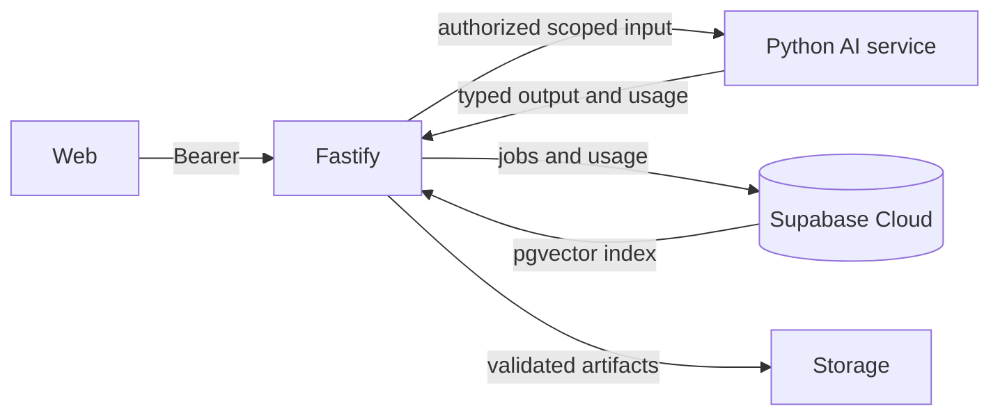

# Target AI architecture

**Recommendation for review:** a Python FastAPI AI service performs model-facing parsing, embedding, generation, image edit and culling. Fastify retains Auth, project access, public API, queue/job ledger, cost reservation, Storage writes and all business action confirmation. This gives the AI Developer a bounded service contract while preserving the MVP UI and business rules.

Use a versioned embedding model with exact vector dimension and a repeatable indexing pipeline. Fastify may call AI synchronously for bounded query parsing/assistant requests and asynchronously for concept/edit/cull/index jobs. The worker must recheck project access and content state before sending private inputs. Enforce timeouts, bounded tokens/image counts, spend reservations and “uncertain” outcome semantics. Preserve provenance labels (`captured`, `manipulated`, `ai_generated`) throughout UI, DB and media.

The alternative of retaining TypeScript AI SDK 7 is technically viable in the MVP branch, but the transition explicitly assigns a new AI Developer and requests a rebuilt AI service. Decide transport, model provider, output schemas, cost owner and deployment topology with Backend/DevOps before implementation. No cloud AI resource or model was used in this documentation session.
