# FrameRoom: ERD MVP (bản nháp v0, cần review trước khi dùng)

**Vị trí trong repo:** `docs/db/erd_v0.md`
**Đầu vào:** `contract_v0.md` (v0.7), `week1.md` mục 6, `contributing.md` mục 5.
**Trạng thái:** đã cập nhật theo các quyết định review ngày 2026-10-20; vẫn là bản thiết kế, chưa freeze. Mục **[?]** ở mục 6 là câu hỏi còn mở.
**Nguồn sự thật cuối cùng của schema:** SQL migration trong `supabase/migrations/`. File này chỉ là bản thiết kế.

---

## 1. Nguyên tắc thiết kế

- Quy ước theo `contributing.md` mục 5.2: bảng số nhiều `snake_case`, PK `id uuid` sinh UUIDv7 phía server (hàm sinh do migration cung cấp; không dùng `gen_random_uuid()`), mọi bảng có `created_at`/`updated_at` (`timestamptz`), FK dạng `<bảng_số_ít>_id`, trạng thái dùng enum Postgres.
- Các bảng mặc định có PK `id`, trừ PK ghép/PK dùng FK được ghi rõ bên dưới. `profiles.id` sao chép nguyên `auth.users.id`; không sinh lại hoặc ép version ID do Supabase Auth quản lý. FK tới user giữ cùng ID đó. UUID cho tên file mới dùng v7. Không đổi giá trị PK/FK hiện có.
- Enum DB đặt tên `snake_case` trùng với `Enum` trong contract mục 3.1 (ví dụ `booking_status`, `genre`). Giá trị giống hệt contract; ngoại lệ tên hiện có: `user_role` tương ứng `Role`. `RegistrationRole`, `BookingSide`, `SearchParsedKey`, `TimelineItemType` chỉ dùng ở API, không cần cột DB riêng.
- Contract trả `...Url`; DB lưu `...path` (đường dẫn trong bucket) và BE sinh URL/signed URL. Các bucket public/private theo contract mục 2.6.
- Ảnh có thumbnail dùng quy tắc tên `{uuid}_thumb.webp`; DB chỉ cần lưu path ảnh chính, BE suy ra path thumbnail.
- Email lấy từ `auth.users`, không lặp trong `profiles`.
- Các giá trị **suy ra được** (`roles` ngoại trừ `system_admin`, `portfolioCount`, `memberCount`, `imageCount`, `selectedCount`, `currentBriefVersion`, `shootRoomId`, `resourceIds` từ `booking_resources`, `participants`) **không lưu cột**, tính bằng query/view. Ngoại lệ: `rating_avg`, `review_count` và `price_from` lưu sẵn, cập nhật bằng trigger vì dùng để lọc/sắp xếp.
- Xoá mềm theo nhóm: `portfolios`, `studios`, `services`, `service_add_ons`, `resources`, `reviews`; portfolio bị soft-delete giữ bản ghi và media 30 ngày rồi cleanup cứng bằng script. Xoá cứng ảnh bị xoá riêng lẻ và các dữ liệu con/tạm theo contract mục 2.4; booking không bị xoá, huỷ bằng trạng thái `cancelled`.
- Chống trùng lịch bằng exclusion constraint (`tstzrange` + `btree_gist`), khoảng nửa mở `[start, end)` khớp contract 2.1.
- Bảng RLS bật mặc định từ chối; chính sách chi tiết ở ma trận RLS riêng (`docs/db/`), file này chỉ liệt kê hàm hỗ trợ (mục 4).

---

## 2. Sơ đồ quan hệ (tổng quan)

```mermaid
erDiagram
  profiles ||--o{ user_roles : stores_admin_role
  profiles ||--o| photographers : has_profile
  photographers ||--o{ studio_members : member_of
  photographers ||--o{ studios : creates
  studios ||--o{ studio_members : has_members
  studios ||--o{ studio_invitations : invites
  photographers ||--o{ studio_invitations : invited_photographer

  photographers |o--o{ portfolios : owns
  studios |o--o{ portfolios : owns
  portfolios ||--o{ portfolio_images : contains
  portfolio_images ||--o{ image_tags : tagged
  tags ||--o{ image_tags : tag

  photographers |o--o{ services : owns
  studios |o--o{ services : owns
  services ||--o{ service_add_ons : has

  studios ||--o{ resources : has
  resources |o--o{ schedule_entries : reserves
  photographers |o--o{ schedule_entries : busy

  profiles ||--o{ bookings : customer
  photographers |o--o{ bookings : provider
  studios |o--o{ bookings : provider
  photographers |o--o{ bookings : assigned
  services |o--o{ bookings : service_snapshot_source
  bookings ||--o{ booking_add_ons : snapshots
  bookings ||--o{ brief_versions : versions
  bookings ||--o{ booking_status_events : history
  bookings ||--o{ booking_assignment_events : assignment_history
  photographers |o--o{ booking_assignment_events : previous_assignee
  photographers ||--o{ booking_assignment_events : new_assignee
  profiles ||--o{ booking_assignment_events : assigns
  bookings ||--o{ booking_resources : resource_snapshots
  resources ||--o{ booking_resources : snapshot_source
  bookings ||--o{ schedule_entries : reserves

  bookings ||--o| shoot_rooms : opens
  shoot_rooms ||--o{ messages : has
  messages ||--o{ message_attachments : attaches
  shoot_rooms ||--o{ decisions : has
  shoot_rooms ||--o{ milestones : has

  bookings ||--o| galleries : has
  galleries ||--o{ gallery_images : contains
  gallery_images ||--o{ image_notes : notes
  bookings ||--o| deliveries : has
  deliveries ||--o{ delivery_items : contains
  gallery_images |o--o{ delivery_items : preview_source

  bookings ||--o| reviews : receives
  profiles ||--o{ reviews : writes
  photographers |o--o{ reviews : about
  studios |o--o{ reviews : about
  profiles |o--o{ messages : sender
  profiles ||--o{ reports : submits

  profiles {
    uuid id PK,FK "Supabase Auth ID, preserved"
    text user_name UK "NN; lowercase; 3-30 characters"
  }
  photographers {
    uuid id PK "UUIDv7"
    uuid user_id FK,UK "profiles.id; NN"
  }
  studios {
    uuid id PK "UUIDv7"
    uuid created_by FK "photographers.user_id; NN; not unique"
  }
  studio_members {
    uuid id PK "UUIDv7"
    uuid studio_id FK "NN; unique together with user_id"
    uuid user_id FK "photographers.user_id; NN"
    studio_member_role role "manager or photographer"
  }
  bookings {
    uuid id PK "UUIDv7"
    uuid customer_id FK "NN; ON DELETE RESTRICT"
    provider_type provider_type "NN; XOR provider FKs"
    uuid photographer_id FK "RESTRICT; personal provider"
    uuid studio_id FK "RESTRICT; studio provider"
    uuid assigned_photographer_id FK "RESTRICT; required for confirmed studio booking"
    integer service_photo_count "Snapshot; nullable; nonnegative"
    integer service_retouched_count "Snapshot; nullable; nonnegative"
    integer total_price "NN; service snapshot plus add-ons"
    booking_status status "NN"
    timestamptz scheduled_start "Both null or valid interval"
    timestamptz scheduled_end "Both null or valid interval"
    integer agreed_brief_version FK "Same booking; both sides approved"
  }
  booking_resources {
    uuid booking_id PK,FK "RESTRICT; composite PK"
    uuid resource_id PK,FK "RESTRICT; composite PK"
    text resource_name "NN; snapshot"
    resource_type resource_type "NN; snapshot"
  }
  booking_assignment_events {
    uuid id PK "UUIDv7; append-only"
    uuid booking_id FK "NN; RESTRICT"
    uuid from_photographer_id FK "Nullable; RESTRICT"
    uuid to_photographer_id FK "NN; RESTRICT"
    uuid actor_id FK "NN; manager; RESTRICT"
    timestamptz created_at "NN; no updated_at"
  }

  portfolio_images {
    integer width "NN; 1-1280"
    integer height "NN; 1-1280"
  }
  gallery_images {
    integer width "NN; 1-1280"
    integer height "NN; 1-1280"
  }
  reviews {
    uuid booking_id FK,UK "NN; unconditional unique including soft-deleted rows"
  }
```

---

## 3. Chi tiết bảng

Ký hiệu: `PK`, `FK`, `UQ`, `NN` = not null. Cột `created_at`/`updated_at` có ở mọi bảng, không liệt kê lại (trừ bảng chỉ có `created_at`).

### 3.1 Tài khoản

**`profiles`** (id trùng `auth.users.id`)

| Cột | Kiểu | Ghi chú |
|---|---|---|
| id | uuid PK, FK `auth.users` on delete cascade | |
| user_name | text UQ NN | 3–30 ký tự; CHECK `^[a-z0-9][a-z0-9_]{2,29}$`; trim + lowercase trước ghi; URL `/u/{userName}` |
| display_name | text NN | check 1–60 ký tự |
| avatar_path | text | bucket `avatars` |

**`user_roles`**: PK `(user_id, role)`

| Cột | Kiểu | Ghi chú |
|---|---|---|
| user_id | uuid FK `profiles` | |
| role | enum `user_role` | Dữ liệu lưu chỉ có `system_admin` (CHECK `role = 'system_admin'`) |
| granted_at | timestamptz | |

Quy tắc đã chốt: chỉ tự đăng ký `client` hoặc `photographer` (enum API `RegistrationRole`, không lưu cột role đăng ký). `client` là quyền cơ bản luôn có trên tài khoản; chỉ `system_admin` được lưu trong `user_roles` và cấp thủ công. `photographer` được suy ra từ việc tồn tại hồ sơ trong `photographers`; `studio_manager` được suy ra khi người dùng có ít nhất một dòng `studio_members` với `role = manager` thuộc studio chưa soft-delete. Không có tài khoản studio riêng. `studio_manager` không được chọn khi đăng ký; `system_admin` không được cấp từ request/metadata client. Photographer phải hoàn tất tạo hồ sơ trước khi tạo studio. Rời studio cuối cùng chỉ làm mất role `studio_manager`, không ảnh hưởng role `photographer`.

`user_name` duy nhất toàn hệ thống sau chuẩn hoá, khác `display_name`; API dùng `userName`. Sai định dạng trả 400, vi phạm UQ trả 409 `user_name_taken`. Profile phải có username hợp lệ trước khi hoàn tất onboarding; ghi và kiểm tra UQ nguyên tử. Đổi username làm URL cũ trả 404; MVP không lưu alias/redirect.

### 3.2 Photographer và studio

**`photographers`**

| Cột | Kiểu | Ghi chú |
|---|---|---|
| user_id | uuid UQ NN FK `profiles` | Chủ hồ sơ |
| display_name | text NN | 1–60 |
| bio | text | ≤ 1000 |
| genres | `genre[]` NN | check 1–5 phần tử |
| styles | text[] | check ≤ 10 phần tử, mỗi tag ≤ 30 ký tự (**[?]** #2) |
| professional_roles | `professional_role[]` NN default `{}` | Vai trò chuyên môn hiển thị, ví dụ `retoucher`, `art_director`; không cấp quyền/workflow |
| city, district | text | |
| price_from | integer | Giá thấp nhất service đang hoạt động; trigger cập nhật, `null` nếu không có |
| avatar_path, cover_image_path | text | `avatars` và bucket bổ sung đề xuất `profile-covers` |
| rating_avg | numeric(2,1) | null nếu chưa có review; trigger cập nhật |
| review_count | integer NN default 0 | trigger cập nhật |
| is_hidden | boolean NN default false | Admin ẩn hồ sơ khi xử lý báo cáo; ẩn khỏi danh sách, Explore, tìm kiếm công khai và không nhận booking mới |

Index: `(city, district)`, GIN `genres`, GIN `styles`.

**`studios`**

| Cột | Kiểu | Ghi chú |
|---|---|---|
| name | text NN | 1–80 |
| description | text | ≤ 2000 |
| avatar_path, cover_image_path | text | Buckets `avatars` và `profile-covers` |
| genres | `genre[]` NN | 1–5 |
| city, district, address | text | address ≤ 200 |
| price_from | integer | Giá thấp nhất service đang hoạt động; trigger cập nhật, `null` nếu không có |
| rating_avg, review_count | như photographers | |
| is_hidden | boolean NN default false | Admin ẩn hồ sơ khi xử lý báo cáo; ẩn khỏi danh sách, Explore, tìm kiếm công khai và không nhận booking mới |
| created_by | uuid NN FK `photographers(user_id)` ON DELETE RESTRICT | User của photographer sáng lập; bất biến, không UQ; quyền hiện tại theo membership |
| deleted_at | timestamptz | Xoá mềm |

**`studio_members`**

| Cột | Kiểu | Ghi chú |
|---|---|---|
| studio_id | uuid NN FK `studios` | |
| user_id | uuid NN FK `photographers(user_id)` ON DELETE RESTRICT | Mọi thành viên, kể cả manager, phải có hồ sơ photographer |
| role | enum `studio_member_role` | `manager`, `photographer`; vai trò chuyên môn không nằm ở đây |
| joined_at | timestamptz | |

`UQ (studio_id, user_id)`; không unique riêng `user_id` hoặc `studios.created_by`: một photographer có thể lập nhiều studio và tham gia nhiều studio, với vai trò khác nhau ở mỗi studio. Không lưu thêm `photographer_id`; suy ra qua `photographers.user_id` (UQ). FK bắt buộc hồ sơ photographer cho cả manager và photographer, đồng thời ngăn xoá hồ sơ khi còn được tham chiếu.

Tạo studio và dòng thành viên đầu tiên (`user_id = created_by`, `role = manager`) trong cùng transaction, lấy user từ token. Constraint trigger deferred tới commit bảo đảm mọi studio chưa soft-delete có ít nhất một manager; khoá dòng studio khi thay đổi thành viên để tránh hai manager cùng rời gây mất manager cuối cùng (422). Xoá cứng dòng thành viên khi rời studio. `created_by` chỉ truy vết, không cấp quyền nếu người sáng lập đã rời studio. `studio_manager` suy ra từ membership hiện tại; `retoucher`/`art_director` chỉ nằm trong `photographers.professional_roles`.

**`studio_invitations`**

| Cột | Kiểu | Ghi chú |
|---|---|---|
| studio_id | uuid NN FK | |
| photographer_id | uuid NN FK `photographers` | Người được mời |
| role | `studio_member_role` | default `photographer` |
| status | enum `invitation_status` | `pending`, `accepted`, `declined`, `revoked` |
| invited_by | uuid FK `profiles` | |
| responded_at | timestamptz | |

Partial unique: `(studio_id, photographer_id) WHERE status = 'pending'` (409 `already_exists`).

### 3.3 Dịch vụ

**`services`**

| Cột | Kiểu | Ghi chú |
|---|---|---|
| owner_type | enum `provider_type` NN | |
| photographer_id | uuid FK | |
| studio_id | uuid FK | |
| name | text NN | 1–100 |
| description | text | ≤ 1000 |
| genre | `genre` NN | |
| duration_minutes | integer NN | > 0 |
| price | integer NN | ≥ 0 (VND) |
| photo_count, retouched_count | integer | |
| is_active | boolean NN default true | |
| deleted_at | timestamptz | |

Check XOR: `owner_type = 'photographer'` ⇒ `photographer_id` not null và `studio_id` null; ngược lại với `studio`.

**`service_add_ons`**: `service_id` FK NN, `name` NN (1–100), `description` (≤ 500), `price` ≥ 0, `is_active`, `deleted_at`.

### 3.4 Portfolio và tag

**`portfolios`**

| Cột | Kiểu | Ghi chú |
|---|---|---|
| owner_type | enum `provider_type` NN | `photographer` hoặc `studio` |
| photographer_id | uuid FK | Có khi `owner_type = photographer` |
| studio_id | uuid FK | Có khi `owner_type = studio` |
| title | text NN | 1–120 |
| genre | `genre` NN | |
| description | text | ≤ 2000 |
| status | enum `portfolio_status` NN default `draft` | `hidden` chỉ admin đặt; khác `deleted_at` |
| cover_image_id | uuid FK `portfolio_images` ON DELETE SET NULL | deferrable; null thì lấy ảnh `sort_order` nhỏ nhất; BE kiểm tra ảnh thuộc portfolio |
| published_at | timestamptz | Đặt lúc publish; reset `null` khi về `draft`; cập nhật khi publish lại |
| deleted_at | timestamptz | Soft-delete; cleanup portfolio, images và files sau 30 ngày |

Check XOR: `owner_type = photographer` ⇒ `photographer_id` not null, `studio_id` null; `owner_type = studio` ⇒ ngược lại. Photographer sở hữu portfolio qua hồ sơ photographer; studio sở hữu portfolio riêng qua `studio_id` và manager của studio quản lý nó.

Index: `(status, published_at desc)`, `(photographer_id)`, `(studio_id)`, với truy vấn công khai luôn loại `deleted_at IS NOT NULL`.

**`portfolio_images`**

| Cột | Kiểu | Ghi chú |
|---|---|---|
| portfolio_id | uuid NN FK | |
| storage_path | text NN | bucket `portfolio-images`; thumbnail path được suy ra bằng suffix `_thumb` |
| width, height | integer NN | CHECK mỗi chiều `> 0` và `<= 1280`; khớp metadata ảnh BE xác minh trong Storage |
| caption | text | ≤ 300 |
| provenance | enum `provenance` NN default `captured` | |
| sort_order | integer NN | từ 0 |
| is_hidden | boolean NN default false | Admin ẩn (contract mục 17); vì bucket public, cờ này ẩn ảnh khỏi API nhưng không thu hồi URL Storage trực tiếp |
| source, collected_at, license_note | text, timestamptz, text | Cho ảnh demo (README mục 7); null với ảnh do photographer đăng |

**`tags`**: `slug` UQ NN, `name` NN, `kind` enum `tag_kind` NN (`tone`, `setting`, `mood`). Nhóm ban đầu; danh sách tag chi tiết chờ taxonomy (câu hỏi #2). Thêm nhóm phải cập nhật enum DB và API cùng nhau.

**`image_tags`**: PK `(portfolio_image_id, tag_id)`, `source` enum `tag_source` NN (`manual`, `ai`), `confidence` numeric(3,2) null. Trả lời một phần câu hỏi "ai gán tag" ở contract #2.

**`image_embeddings`** (**chưa tạo trong migration v0**, tách riêng theo README/week1): `portfolio_image_id` PK FK, `model` text, `embedding vector(<dim>)`, `created_at`. Chiều vector chờ chọn model; index HNSW khi triển khai AI Search.

### 3.5 Lịch và tài nguyên

**`resources`**: `studio_id` FK NN, `type` enum `resource_type` NN, `name` NN (1–80), `description` (≤ 500), `is_active`, `deleted_at`.

**`schedule_entries`**

| Cột | Kiểu | Ghi chú |
|---|---|---|
| type | enum `schedule_entry_type` NN | `booking` hoặc `block` |
| booking_id | uuid FK | Bắt buộc khi `type = booking` |
| resource_id | uuid FK `resources` | |
| photographer_id | uuid FK | |
| studio_id | uuid FK | Studio tạo block / sở hữu mục |
| during | tstzrange NN | `[start, end)` |
| title | text | |
| created_by | uuid FK `profiles` | |

Cách dùng: một booking xác nhận tạo **một dòng cho mỗi tài nguyên** và **một dòng cho photographer** (cùng `booking_id`). `schedule_entries` dùng giữ lịch; `Booking.resourceIds` suy ra từ `booking_resources` (snapshot lịch chốt gần nhất). Huỷ booking thì xoá các dòng giữ lịch, giữ nguyên snapshot tài nguyên và thời gian trên booking để xem lại.

Ràng buộc:
- Check XOR: mỗi dòng chỉ có một trong `resource_id`, `photographer_id`; `type = booking` khi và chỉ khi `booking_id` có giá trị.
- `during` hữu hạn, không rỗng, có `lower < upper` và dùng `[start, end)`. Với dòng booking, `during = tstzrange(bookings.scheduled_start, bookings.scheduled_end, '[)')`; dòng giữ tài nguyên chỉ hợp lệ với booking `provider_type = studio` và tài nguyên thuộc studio đó; booking photographer cá nhân không có resource entry. Photographer phải khớp người được phân công (hoặc provider cá nhân). Deferred constraint trigger kiểm tra tính khớp ở commit, kể cả khi xoá/chèn dòng lịch: booking đã xác nhận chưa huỷ phải có đúng một dòng photographer và một dòng cho mỗi tài nguyên trong snapshot; booking bị huỷ không còn dòng giữ lịch.
- Xác nhận, đổi người và đổi lịch phải khoá booking, kiểm tra lại trạng thái rồi cập nhật booking/lịch/snapshot/event liên quan trong cùng transaction. Vi phạm exclusion constraint rollback toàn bộ và trả 409 `slot_overlap`.
- `EXCLUDE USING gist (resource_id WITH =, during WITH &&) WHERE (resource_id IS NOT NULL)`
- `EXCLUDE USING gist (photographer_id WITH =, during WITH &&) WHERE (photographer_id IS NOT NULL)`
- Ràng buộc theo `photographer_id` chặn trùng lịch của một photographer **xuyên studio và cả khi làm độc lập**. Vi phạm ánh xạ sang 409 `slot_overlap`.

### 3.6 Booking và Shoot Brief

**`bookings`**

| Cột | Kiểu | Ghi chú |
|---|---|---|
| customer_id | uuid NN FK `profiles` ON DELETE RESTRICT | Giữ lịch sử booking khi xoá tài khoản |
| provider_type | enum `provider_type` NN | |
| photographer_id | uuid FK `photographers` ON DELETE RESTRICT | Khi `provider_type = photographer` |
| studio_id | uuid FK `studios` ON DELETE RESTRICT | Khi `provider_type = studio` |
| assigned_photographer_id | uuid FK `photographers` ON DELETE RESTRICT | Booking studio; bắt buộc từ `confirmed` trở đi; booking cá nhân luôn null |
| service_id | uuid FK `services` | on delete set null; chỉ để tham chiếu |
| service_name | text NN | Snapshot |
| service_price | integer NN | Snapshot, ≥ 0 |
| service_duration_minutes | integer NN | Snapshot, > 0 |
| service_photo_count, service_retouched_count | integer | Snapshot số ảnh gói lúc đặt; null nếu service không quy định, còn lại ≥ 0 |
| total_price | integer NN | BE tính `service_price + SUM(booking_add_ons.price)`, ≥ 0; cố định khi tạo trong MVP |
| status | enum `booking_status` NN default `pending` | Chỉ đổi qua state machine ở service |
| scheduled_start, scheduled_end | timestamptz | Có từ `confirmed` |
| status_reason | text | |
| agreed_brief_version | integer | Cặp `(id, agreed_brief_version)` FK sang `brief_versions(booking_id, version)` |

Check:
- XOR bên cung cấp: `provider_type = photographer` ⇒ `photographer_id` not null, `studio_id` null; `studio` ⇒ ngược lại, `photographer_id` null.
- Mọi trạng thái: `scheduled_start` và `scheduled_end` cùng null, hoặc cùng có giá trị và `scheduled_end > scheduled_start` (CHECK phải kiểm tra null tường minh).
- `status IN ('confirmed','in_progress','proofing','delivered','completed')` ⇒ cả hai mốc thời gian không null. Cùng tập trạng thái này, `provider_type = studio` ⇒ `assigned_photographer_id IS NOT NULL`. Không so sánh theo thứ tự enum.
- `provider_type = photographer` ⇒ `assigned_photographer_id IS NULL` và không có `booking_resources`/resource entry. Booking đã huỷ giữ người được phân công và thời gian trước đó nếu có.
- `status IN ('in_progress','proofing','delivered','completed')` ⇒ `agreed_brief_version IS NOT NULL`; deferred constraint trigger kiểm tra phiên bản được trỏ tới có cả hai dấu chấp thuận.
- Bảng không có `deleted_at`: booking không bị xoá, huỷ bằng `cancelled` (contract mục 2.4).

Quy tắc BE: khách không tự đặt chính mình; `service` phải thuộc bên cung cấp; photographer được phân công phải là thành viên hiện tại của studio. Snapshot service/add-on và `total_price` được chốt nguyên tử khi tạo booking; sửa service hoặc `brief.budget` không thay giá booking.

Chặn rời/bị loại khỏi studio nếu photographer đang được giao booking chưa kết thúc (`pending`, `confirmed`, `in_progress`, `proofing`, `delivered`), trả 422 `active_booking_assignment`; cần chuyển giao ở trạng thái cho phép hoặc kết thúc booking trước. Kiểm tra này ở trigger và BE, phối hợp khoá dòng studio giữa thao tác phân công và xoá membership để tránh race. Không dùng FK tới dòng membership vì lịch sử booking phải tồn tại sau khi thành viên rời.

FK khách/provider/assignee dùng RESTRICT, không cascade xoá booking. Vì `profiles.id` liên kết Auth bằng CASCADE, xoá Auth user có booking cũng bị chặn; MVP giữ tài khoản/hồ sơ được tham chiếu thay vì xoá cứng. Xoá mềm studio không xoá booking.

Xác nhận booking phải cập nhật trạng thái, giữ lịch, snapshot tài nguyên, ghi event và tạo Shoot Room trong cùng transaction. Các lần chuyển trạng thái khác cũng cập nhật toàn bộ tác dụng phụ (gallery/delivery/phòng/lịch) và event nguyên tử; khoá booking và kiểm tra lại trạng thái để chống hai request chuyển đồng thời.

Phân công/thay người chỉ ở `pending`, `confirmed`, `in_progress`; trạng thái cuối và từ `proofing` trở đi bị từ chối. `pending` chưa giữ lịch; ở `confirmed`/`in_progress`, chuyển dòng lịch photographer sang người mới trong cùng transaction, giữ nguyên giờ/tài nguyên; xung đột rollback và trả 409.

Đổi giờ/tài nguyên chỉ ở `confirmed`, do provider cá nhân hoặc manager studio; giữ nguyên assignee, cập nhật booking, toàn bộ lịch giữ và snapshot tài nguyên nguyên tử. Tài nguyên phải thuộc studio và đang hoạt động, danh sách không trùng. Không có luồng đổi lịch từ `in_progress` trở đi trong MVP.

Index: `(customer_id, status)`, `(photographer_id, status)`, `(studio_id, status)`, `(assigned_photographer_id)`.

**`booking_add_ons`** (snapshot): `booking_id` FK NN ON DELETE RESTRICT, `add_on_id` FK (set null), `name` NN, `price` NN (≥ 0). Snapshot bất biến sau khi tạo booking.

**`booking_resources`** (snapshot cấu hình tài nguyên chốt gần nhất): PK `(booking_id, resource_id)`, không có `id` riêng.

| Cột | Kiểu | Ghi chú |
|---|---|---|
| booking_id | uuid NN FK `bookings` ON DELETE RESTRICT | |
| resource_id | uuid NN FK `resources` ON DELETE RESTRICT | Tài nguyên cùng studio với booking |
| resource_name | text NN | Snapshot tên lúc xác nhận/đổi lịch |
| resource_type | enum `resource_type` NN | Snapshot loại tài nguyên |

Tạo snapshot khi xác nhận; khi đổi lịch được phép thì thay tập snapshot trong cùng transaction với giữ lịch, tái chụp từ tài nguyên hiện tại. Huỷ hoặc kết thúc booking không xoá snapshot; đổi tên/xoá mềm resource không sửa snapshot. Đây là cấu hình chốt gần nhất, không phải log mọi lần đổi tài nguyên. Chỉ cho ghi ở luồng xác nhận/đổi lịch; `resourceIds` suy ra từ bảng này, kể cả sau khi huỷ.

**`booking_assignment_events`** (append-only, chỉ `created_at`, không `updated_at`)

| Cột | Kiểu | Ghi chú |
|---|---|---|
| booking_id | uuid NN FK `bookings` ON DELETE RESTRICT | Chỉ booking studio |
| from_photographer_id | uuid FK `photographers` ON DELETE RESTRICT | null khi phân công lần đầu |
| to_photographer_id | uuid NN FK `photographers` ON DELETE RESTRICT | Người mới; phải khác người cũ nếu người cũ không null |
| actor_id | uuid NN FK `profiles` ON DELETE RESTRICT | Manager thực hiện |
| created_at | timestamptz NN | Thời điểm phân công |

Ghi cả lần phân công đầu tiên (qua assignment hoặc xác nhận) và các lần thay người, cùng transaction với booking/lịch. Gửi lại cùng assignee là no-op, không ghi thêm event. Index `(booking_id, created_at, id)`. Manager quản lý assignment; photographer được giao không tự giao lại booking. Sau đổi người, quyền booking/Shoot Room chuyển theo assignee hiện tại: người cũ mất quyền qua assignment, người mới xem lịch sử phòng; quyền độc lập của customer/manager vẫn giữ.

**`brief_versions`** (bất biến, trừ cột phê duyệt)

| Cột | Kiểu | Ghi chú |
|---|---|---|
| booking_id | uuid NN FK | |
| version | integer NN | từ 1; `UQ (booking_id, version)` |
| created_by | uuid NN FK `profiles` | |
| genre | `genre` NN | |
| concept | text NN | 1–2000 |
| location_type | enum `location_type` NN | |
| location_note | text | ≤ 300 |
| preferred_start, preferred_end | timestamptz | |
| people_count | integer | ≥ 1 |
| reference_paths | text[] | Ánh xạ `content.references` của contract; tối đa 10 storage path trong bucket riêng tư `brief-references`, dạng `{user_id}/{uuid}.webp` |
| revision_rounds | integer NN default 1 | Số vòng sửa thêm sau vòng đầu; check `>= 0` |
| photo_count, retouched_count | integer | |
| budget | integer | |
| notes | text | ≤ 1000 |
| customer_approved_at | timestamptz | |
| provider_approved_at | timestamptz | |
| provider_approved_by | uuid FK `profiles` | Photographer hoặc manager phía cung cấp |

`currentBriefVersion` = `max(version)`. `agreedBriefVersion` lưu ở `bookings`; chỉ cập nhật khi bản mới nhất được cả hai bên chấp thuận. Tạo bản mới không xoá dấu duyệt của bản cũ và không reset `agreed_brief_version`: bản đã thống nhất tiếp tục có hiệu lực cho tới khi được thay thế. Nếu chưa có bản được thống nhất, giá trị vẫn null.

Khoá booking khi cấp số version, tạo/duyệt phiên bản và cập nhật con trỏ agreed; kiểm tra lại trạng thái và bản mới nhất trong transaction. Duyệt chỉ ghi nhận phía người gọi, không tự duyệt cả hai bên. Bản mới có thời gian mong muốn khác không tự đổi lịch giữ; đổi lịch phải đi qua luồng riêng ở contract mục 12.2.

**`booking_status_events`** (đã thống nhất cho MVP)

| Cột | Kiểu | Ghi chú |
|---|---|---|
| booking_id | uuid NN FK | |
| from_status, to_status | `booking_status` NN | Chỉ ghi các lần chuyển trạng thái; không cần event riêng cho lần tạo booking ban đầu |
| actor_id | uuid FK `profiles` | null nếu hệ thống (tự hoàn tất) |
| reason | text | |
| created_at | timestamptz | |

Dùng cho audit, tin nhắn hệ thống, timeline và các chỉ số đúng hạn về sau.

### 3.7 Shoot Room

**`shoot_rooms`**: `booking_id` UQ NN FK, `status` enum `shoot_room_status` (`open`, `closed`) NN default `open`, `closed_at`.
Người tham gia **không lưu bảng**, suy ra từ booking qua `is_booking_participant()`. Khi đổi assignee, người cũ mất quyền từ assignment, người mới được xem toàn bộ lịch sử phòng; customer/manager vẫn giữ quyền độc lập. BE/RLS/Storage và subscription Realtime phải kiểm tra lại quyền hiện tại; dữ liệu đã tải về trước đó không thể thu hồi. Phạm vi thành viên studio khác vẫn là câu hỏi #11.

**`messages`**

| Cột | Kiểu | Ghi chú |
|---|---|---|
| shoot_room_id | uuid NN FK | |
| sender_id | uuid FK `profiles` | null với tin hệ thống |
| type | enum `message_type` NN | |
| body | text | ≤ 2000 |
| is_hidden | boolean NN default false | Admin ẩn |

Index: `(shoot_room_id, created_at desc, id desc)`. Check: `body` hoặc có đính kèm. Phân trang con trỏ: contract dùng `before=<messageId>`; ID tin mới dùng UUIDv7; vẫn truy vấn theo `(created_at, id)` của tin mốc trong cùng phòng để giữ thứ tự nhất quán khi nhiều tin cùng mili giây. UUIDv7 không thay timestamp nghiệp vụ.

**`message_attachments`**: `message_id` FK NN, `storage_path` NN (bucket riêng tư `room-files`), `width`, `height`; thumbnail chỉ cho ảnh và suy ra từ path ảnh chính. Trigger giới hạn ≤ 5 attachment mỗi tin.

**`decisions`**: `shoot_room_id` FK NN, `title` NN (1–120), `content` NN (1–1000), `status` enum `decision_status` default `proposed`, `proposed_by` FK NN, `responded_by` FK, `responded_at`. Check: `responded_by` khác bên đề xuất (BE kiểm tra thêm "bên còn lại").

**`milestones`**: `shoot_room_id` FK NN, `title` NN (1–120), `due_at`, `status` enum `milestone_status` default `todo`, `done_at`, `created_by` FK NN.

### 3.8 Chọn ảnh và bàn giao

**`galleries`**: `booking_id` UQ NN FK, `status` enum `gallery_status` default `draft`, `selection_limit` integer (null = không giới hạn), `submitted_at`, `round` integer NN default 1 (check `>= 1`). `round` tăng khi `selection/reopen` được chấp nhận, không tăng khi submit; giới hạn lấy từ brief đã thống nhất (`revision_rounds`, mặc định 1).

**`gallery_images`**: `gallery_id` FK NN, `storage_path` NN (bucket riêng tư `gallery-previews`; thumbnail path suy ra), `width`, `height`, `sort_order`, `is_selected` boolean NN default false. `selectedCount` = đếm `is_selected`. Lịch sử lựa chọn từng vòng vẫn là câu hỏi mở (**[?]** #18); MVP hiện giữ lựa chọn hiện tại.

**`image_notes`**: `gallery_image_id` FK NN, `author_id` FK NN, `body` NN (1–500), `x`, `y` numeric, check `0 ≤ x,y ≤ 1` và `(x IS NULL) = (y IS NULL)`.

**`deliveries`**: `booking_id` UQ NN FK, `status` enum `delivery_status` default `preparing`, `note` (≤ 1000), `delivered_at`, `expires_at` (**[?]** #12).

**`delivery_items`**: `delivery_id` FK NN, `storage_path` NN (bucket `deliveries`), `file_name` NN, `mime_type` enum `delivery_mime_type` NN (`image/jpeg`, `image/png`, `image/webp`), `size_bytes` NN, `gallery_image_id` FK (set null).

### 3.9 Review và báo cáo

**`reviews`**

| Cột | Kiểu | Ghi chú |
|---|---|---|
| booking_id | uuid NN UQ FK | Unique không điều kiện: tối đa một review suốt vòng đời booking, kể cả review soft-delete |
| reviewer_id | uuid NN FK `profiles` | Phải là `customer_id` của booking (BE) |
| target_type | enum `provider_type` NN | |
| photographer_id, studio_id | uuid FK | XOR như `services` |
| rating | smallint NN | 1–5 |
| comment | text | ≤ 1000 |
| is_hidden | boolean NN default false | |
| deleted_at | timestamptz | |

Unique không điều kiện trên `booking_id`; POST lại sau soft-delete vẫn trả 409 `already_exists`. Trigger tính lại `rating_avg`, `review_count` của photographer/studio (bỏ qua review đã xoá/ẩn).

**`reports`**

| Cột | Kiểu | Ghi chú |
|---|---|---|
| reporter_id | uuid NN FK `profiles` | |
| target_type | enum `report_target_type` NN | |
| target_id | uuid NN | **Đa hình, không có FK**; BE kiểm tra tồn tại |
| reason | enum `report_reason` NN | |
| detail | text | ≤ 1000 |
| status | enum `report_status` default `open` | |
| resolution | enum `report_resolution` | |
| admin_note | text | ≤ 1000 |
| resolved_by | uuid FK `profiles` | |
| resolved_at | timestamptz | |

Partial unique `(reporter_id, target_type, target_id) WHERE status = 'open'` (409). `content_hidden` ⇒ BE đặt `portfolios.status = hidden` hoặc `is_hidden = true` ở `portfolio_images`, `reviews`, `messages`, `photographers`, `studios`.

---

## 4. Hàm hỗ trợ cho RLS (`SECURITY DEFINER`, đặt trong schema riêng)

| Hàm | Trả về |
|---|---|
| `has_role(uid, role)` | boolean; `client` luôn true với uid đã có profile, `photographer` kiểm tra hồ sơ, `studio_manager` kiểm tra ít nhất một `studio_members.role = manager` thuộc studio chưa soft-delete, `system_admin` kiểm tra `user_roles` |
| `is_studio_member(studio_id, uid)` / `is_studio_manager(studio_id, uid)` | boolean |
| `is_booking_customer(booking_id, uid)` | boolean |
| `is_booking_provider_side(booking_id, uid)` | Chủ hồ sơ, hoặc photographer được phân công, hoặc manager của studio (khớp mục 2.5 contract) |
| `is_booking_participant(booking_id, uid)` | Khách hoặc bên cung cấp |
| `shoot_room_booking_id(shoot_room_id)` | uuid, dùng cho chính sách của messages, decisions, milestones |

`booking_resources` và `booking_assignment_events` chỉ cho người tham gia booking hiện tại đọc qua `is_booking_participant()`. Client không ghi trực tiếp: snapshot chỉ cập nhật qua xác nhận/đổi lịch; assignment events chỉ append qua service trong transaction phân công. Các bản ghi lịch sử không cấp quyền cho assignee cũ.

Kênh Realtime `shoot_room:{roomId}` và `booking:{bookingId}` dùng chính các hàm này trong RLS.

---

## 5. Ràng buộc và trigger tổng hợp

| # | Nội dung | Cơ chế |
|---|---|---|
| 1 | `updated_at` | Trigger chung |
| 2 | Studio đang hoạt động không hết manager; tạo studio và manager đầu tiên nguyên tử | Deferred constraint trigger trên `studios`/`studio_members`, transaction và khoá dòng studio |
| 3 | Vai trò tài khoản được suy ra | `has_role()` kiểm tra `photographers`/`studio_members`; chỉ `system_admin` lưu trong `user_roles` |
| 4 | Chống trùng lịch resource và photographer | Exclusion constraint (mục 3.5) |
| 5 | XOR owner/provider/target | Check constraint cho `services`, `portfolios`, `reviews` |
| 6 | `rating_avg`, `review_count` | Trigger trên `reviews` |
| 7 | `price_from` | Trigger tính giá thấp nhất từ các service đang hoạt động và chưa soft-delete |
| 8 | Tối đa 5 attachment/tin; tối đa 10 ảnh tham chiếu/brief | Trigger/check |
| 9 | Chuyển trạng thái booking hợp lệ | State machine ở service; DB đảm bảo các ràng buộc nhất quán |
| 10 | Mọi thao tác ghi trên phòng `closed` bị từ chối | Chính sách RLS/BE kiểm tra `shoot_rooms.status` |
| 11 | Cleanup portfolio soft-delete quá 30 ngày | Script xoá ảnh chính + thumbnail, bản ghi ảnh, sau đó portfolio đã hết hạn |
| 12 | Người tạo và mọi thành viên studio phải có hồ sơ photographer | FK tới `photographers(user_id)`; BE kiểm tra quyền |
| 13 | Username duy nhất và đúng định dạng | UQ + CHECK, chuẩn hoá trước ghi |
| 14 | Trường phân loại/trạng thái dùng enum | PostgreSQL ENUM đồng bộ contract 3.1, gồm `tag_kind`, `tag_source`, `shoot_room_status`, `delivery_mime_type` |
| 15 | Phân công và thời gian khớp loại/trạng thái booking | CHECK và deferred constraint trigger trên booking/lịch/brief |
| 16 | Không rời studio khi còn booking được giao chưa kết thúc | Trigger + BE, khoá studio chung với luồng assignment |
| 17 | Lịch, snapshot, assignment event và trạng thái nhất quán | Transaction + khoá booking; conflict lịch rollback toàn bộ |
| 18 | Giữ lịch sử booking và tài nguyên | FK RESTRICT, snapshot `booking_resources`, assignment events append-only |
| 19 | Một review mỗi booking kể cả sau soft-delete | Unique không điều kiện trên `reviews.booking_id` |
| 20 | Kích thước ảnh khớp API | CHECK từng chiều `(0, 1280]`; BE xác minh metadata Storage |

---

## 6. Điểm cần chốt trong buổi review ERD

Các vấn đề chưa chốt và quyết định đã chốt được ghi dưới đây, cập nhật ngày 2026-10-20; giữ số thứ tự để các tham chiếu không bị lệch.

| # | Câu hỏi | Người chốt |
|---|---|---|
| 1 | Khởi tạo profile bằng trigger DB hay BE; nhận username bắt buộc, xử lý trùng và lỗi khởi tạo như thế nào? | Ly, Khải |
| 2 | `styles` là `text[]` hay bảng tag chuẩn; taxonomy và cách gán tag cho ảnh ra sao? | Quỳnh Anh, Ly |
| 3 | Giới hạn số ảnh mỗi portfolio và dung lượng tổng mỗi tài khoản. | Cả nhóm |
| 4 | Có cần trường credit ekip dạng chữ tự do trong portfolio không? | Quỳnh Anh |
| 5 | Có cần chỉ số uy tín ngoài `rating_avg`/`review_count` trong MVP không? | Bạn |
| 6 | Có bắt buộc FE hiển thị nhãn cho ảnh `ai_generated` không? | Bạn, Khoa |
| 7 | Đã chốt: ID tin mới dùng UUIDv7, cursor vẫn dùng `(created_at, id)` (mục 3.7). | — |
| 8 | Đã chốt: manager phân công; chặn rời studio khi còn booking được giao chưa kết thúc, lưu lịch sử thay người (mục 3.6). | — |
| 9 | Chính sách huỷ booking, thời gian tự động hoàn tất sau `delivered` và cách xử lý khi khách không phản hồi ở `proofing` (hiện không có đường huỷ từ `proofing`). | Bạn, Khải |
| 10 | Đã chốt: chỉ sửa ở pending/confirmed/in_progress; bản đã thống nhất giữ hiệu lực đến khi bản mới được hai bên duyệt, không sửa từ proofing (mục 3.6). | — |
| 11 | Phạm vi người được vào Shoot Room: chỉ người tham gia booking hay toàn bộ thành viên studio? | Ly, Khải |
| 12 | Giới hạn dung lượng, số lượng và thời hạn lưu file bàn giao/Shoot Room. | Cả nhóm |
| 13 | Review có được sửa/phản hồi; booking studio có đánh giá riêng photographer được phân công không? | Bạn |
| 14 | Photographer độc lập có tự quản lý lịch bận trong MVP không? | Bạn, Khoa |
| 15 | Ngoài xử lý báo cáo, admin cần endpoint nào để kiểm tra dữ liệu tín nhiệm? | Bạn, Quỳnh Anh |
| 16 | AI Search: quyền tìm bằng ảnh, kết quả theo ảnh hay photographer, và thời hạn lưu `search-uploads`. | Quỳnh Anh, Khải |
| 17 | Thông báo đẩy/email/trong app có nằm trong MVP không? Hiện để ngoài. | Cả nhóm |
| 18 | Có cần bảng `gallery_selections` để lưu lịch sử lựa chọn qua từng vòng hay chỉ giữ trạng thái hiện tại? | Bạn, Khoa |

---

## Lịch sử thay đổi

| Phiên bản | Ngày | Nội dung |
|---|---|---|
| v0 | 2026-10-13 | Bản nháp đầu, suy ra từ `contract_v0.md` v0.2. Chưa review. |
| v0.1 | 2026-10-14 | Cập nhật theo review: role suy ra từ dữ liệu; vai trò chuyên môn hiển thị; portfolio thuộc photographer hoặc studio; soft-delete portfolio 30 ngày; bucket/thumbnail paths; brief references, vòng sửa, booking events và trigger `price_from`. Vẫn chưa freeze. |
| v0.2 | 2026-10-14 | Rà soát chéo với contract v0.3: bỏ `bookings.deleted_at`; CHECK lịch theo danh sách trạng thái tường minh; bỏ `studio_members.photographer_id` và thêm trigger; thêm `is_hidden` cho `photographers`/`studios`; đổi `references` thành `reference_paths`; đổi FK `*_id` theo quy ước; sửa tham chiếu câu hỏi mở (#6, #9, #11, #12, #18); bổ sung quan hệ vào sơ đồ |
| v0.3 | 2026-10-20 | Chỉ đăng ký client/photographer; photographer tạo và tham gia nhiều studio; username duy nhất; UUIDv7 cho ID ứng dụng; chuẩn hoá enum. |

| v0.4 | 2026-10-20 | Siết assignment/thời gian, đồng bộ lịch nguyên tử; giữ brief đã thống nhất; snapshot số ảnh dịch vụ và tài nguyên; assignment events; FK RESTRICT bảo toàn booking. |

| v0.5 | 2026-10-20 | Chỉ booking studio được giữ tài nguyên; unique review suốt vòng đời; ràng buộc kích thước ảnh theo API. |
