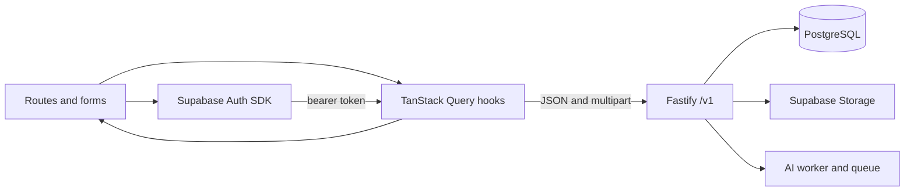

# Frontend data flow

Source: MVP branch `apps/web/src/lib/{auth.tsx,api.ts,hooks.ts,types.ts}`, `App.tsx`, page and feature components. On checked out `main`, only `lib/health.ts` fetches the API.

`useApi` keys reads by account ID and path. `useTask` wraps mutations and cache invalidation. `lib/api.ts` adds bearer token and `Accept-Language`, parses `{data}`, and surfaces stable error codes/reasons. Account changes must clear or isolate private cache; a token refresh must be honored at request time. Public catalog reads can run without a session, while `/v1/search` is protected. `/health` is independent and has a five-second timeout.

Forms are local state until submission. Project and booking pages refetch/poll jobs and workspace; uploads use `POST /v1/uploads` multipart, then register returned Storage paths via catalog/project/booking mutations. A path alone must never grant ownership. Private image reads use short-lived signed URLs; public portfolio images use public URLs. Chat uses the special streaming endpoint; ordinary endpoints use JSON. `useApi` polling and screen-level optimistic control disabling should be checked against stale versions and concurrent edits.

**Migration dependency:** the Frontend Developer transfers the complete UI; Backend Developer preserves the agreed response envelopes and status codes; Database Developer enforces owner/manager visibility; AI Developer supplies async job status and output contract. Error and loading states are implemented in MVP components but have not been revalidated against the rebuilt stack.
