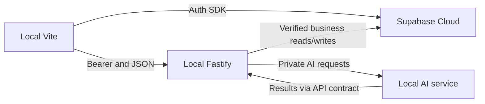

# Target development environment

**Agreed target:** local React/Vite, local Fastify, local replacement AI service only when needed; Supabase Cloud supplies Auth, PostgreSQL, Storage, RLS, Realtime and pgvector for development and testing. Do not start or require a local Supabase instance. This describes the intended future state, not a change already applied.

Keep Auth URL/anon key browser-visible, service-role and database credentials server-only. Fastify owns authorization and business writes; Storage/RLS enforce direct-read boundaries. AI service should not receive service-role credentials unless a narrowly justified design requires them. Separate development and staging Cloud projects; protect production from local demo seeds and destructive commands. A Cloud health/readiness check should distinguish API liveness from database/Auth/Storage/AI readiness.

Cloud latency, network outages and quotas affect local app development. Database Developer and DevOps must coordinate migrations, synthetic seed/demo data, secrets, allowed Auth redirects and Realtime publication before the Frontend UI can be exercised end to end. Use separate Cloud projects for shared development and destructive/concurrency testing so tests cannot disrupt team data.
